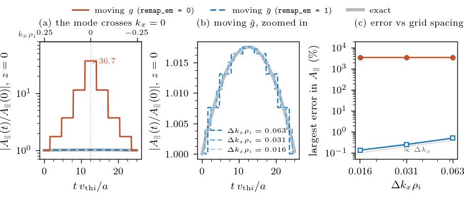
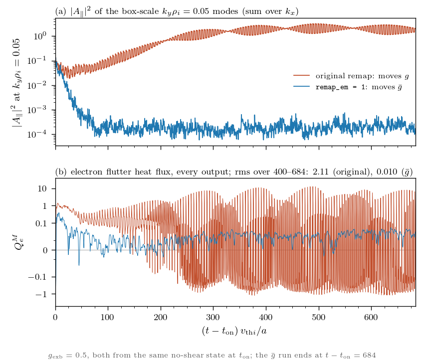

# The Hammett remap in electromagnetic runs: why stella should move $\bar g$

With perpendicular flow shear (`nonzero g_exb`), stella uses the Hammett remap: each $k_y$ mode is moved by one $k_x$ cell whenever the accumulated shear reaches half the $k_x$ grid spacing. In an electromagnetic run there are two distributions the remap could move, and they do not give the same answer. This note explains why $\bar g$ is the right one, and shows the tests
that confirm it. The option is

```
&flow_shear
  remap_em = 1    ! 0 (default): move g, as before; 1: move gbar
/
```

`remap_em` has no effect in electrostatic runs, where $\bar g = g$.

## 1. The two distributions

Stella stores $g_s = \langle\delta f_s\rangle_R$, the gyroaveraged perturbed distribution at fixed
gyrocentre. It is related to the non-Boltzmann part $h_s$ of Abel et al. (2013), $\delta f_s = -Z_s\phi F_s/T_s + h_s$,
by $g_s = h_s - (Z_s/T_s) J_{0s}\phi F_s$. With $A_\parallel$ on, the gyrokinetic equation is advanced for

$$\bar g_s = g_s + b_s v_\parallel J_{0s} A_\parallel F_s, \qquad b_s = 2\frac{Z_s}{T_s}\sqrt{\frac{T_s}{m_s}},$$

which is built from $g$ in `calculations_tofrom_ghf.f90` (`gbar_to_g`).

When the accumulated flow shear displaces a $k_y$ mode by half a $k_x$ grid cell, `advance_perp_flow_shear` remaps the distribution by copying its values, unchanged, to the neighbouring $k_x$ index. The remapped values are then associated with the $k_\perp^2$ and $J_0$ factors of the new grid cell. The option `remap_em` determines whether this operation is applied to $g$ or $\bar g$.

Ampère's law can be solved from either distribution (`field_equations_electromagnetic.f90`, `get_apar`):

$$k_\perp^2 A_\parallel = \mathcal M[g], \qquad (k_\perp^2 + S) A_\parallel = \mathcal M[\bar g],$$

where $\mathcal M[f] = \sum_s \beta Z_s n_s \sqrt{T_s/m_s} \sum_v J_{0s} v_\parallel f_s$ is the parallel current and
$S = \sum_s (2\beta Z_s^2 n_s/m_s) \sum_v v_\parallel^2 J_{0s}^2 F_s$ is the term in `apar_denom` $= k_\perp^2 + S$.
At the scales where flow shear matters, $S \gg k_\perp^2$: in an ITG case with kinetic electrons and
$\beta = 10^{-3}$, $S/k_\perp^2$ is 184 to 2028.

## 2. What happens at a remap

A remap moves the content of a mode to the next $k_x$ cell. The mode's true wavenumber does not change, only its grid
label does. But $k_\perp^2$, $J_0$ and $S$ are taken at the new grid label, so the coefficients of Ampère's law jump.
When the coefficients jump, $g$, $\bar g$ and $A_\parallel$ cannot all remain unchanged because they are linked together through the definition of $\bar g$ and by Ampère's law. The remap must choose which one is kept.

| | $g$ | $A_\parallel$ | $\bar g$ |
|---|---|---|---|
| `remap_em = 0` (move $g$) | kept | $A^+ = A^- k_-^2/k_+^2$: jumps (×0.3 to ×3 in the same ITG case) | jumps |
| `remap_em = 1` (move $\bar g$) | adjusts | $A^+ \approx A^-(k_-^2 + S_-)/(k_+^2 + S_+)$: nearly kept, since $S \gg k_\perp^2$ | kept |

Here $-$ and $+$ mean just before and just after the remap.

## 3. Why $\bar g$ must be kept

**From the gyrokinetic equation.**  With
the sheared flow $\mathbf V = \gamma_E x\,\hat{\mathbf y}$ ($\gamma_E$ = `g_exb * g_exbfac` in stella), the equation is

$$\left(\frac{\partial}{\partial t} + \gamma_E\, x\,\frac{\partial}{\partial y}\right)\bar g = R[\bar g, \phi, A_\parallel],$$

where $R$ collects streaming, mirror, drifts, drive, the nonlinearity and dissipation. In Fourier space
$x \to i\,\partial/\partial k_x$ and $\partial/\partial y \to i k_y$, so for each Fourier mode

$$\frac{\partial \bar g_{k}}{\partial t} - \gamma_E k_y \frac{\partial \bar g_{k}}{\partial k_x}
= \frac{d}{dt}\,\bar g\big(k_x^*(t), k_y, t\big), \qquad k_x^*(t) = k_{x0} - \gamma_E k_y t .$$

The left side is the time derivative along the sheared wavenumber $k_x^*(t)$. Stella uses the same drifted wavenumber,
$k_x - \gamma_E k_y\,$`shift_state`, in its nonlinear term. The Hammett remap follows $k_x^*(t)$ on the grid by moving
each mode one cell whenever $k_x^*$ has drifted half a cell, so the remap is the discrete form of this derivative.

Integrating $d\bar g/dt = R$ across the instant of the remap gives $\Delta\bar g = 0$: $\bar g$ is constant across the remap. Writing the same equation in $g$,

$$\left(\frac{\partial}{\partial t} + \gamma_E\, x\,\frac{\partial}{\partial y}\right) g
+ b v_\parallel F \left(\frac{\partial}{\partial t} + \gamma_E\, x\,\frac{\partial}{\partial y}\right)(J_0 A_\parallel) = R,$$

and integrating across the remap gives $\Delta g = -b v_\parallel F\,\Delta(J_0 A_\parallel)$, which is again
$\Delta\bar g = 0$. Then Ampère's law on the new cell gives $A^+ = \mathcal M_+[\bar g^-]/(k_+^2 + S_+)$. Both forms of
the equation give the same jump condition, and it is what `remap_em = 1` does.

Moving $g$ instead sets $\Delta g = 0$ while $A_\parallel$ jumps. That solves the $g$-form of the equation with an extra
source $b v_\parallel F\,\Delta(J_0 A_\parallel)\,\delta(t - t_r)$: an impulsive parallel electric field, applied to
every remapped mode at every remap.

**GENE moves the same quantity.** GENE evolves and stores $g_1 = f_1 + (q/T)\sqrt{2/(Tm)}\,v_\parallel J_0 A_\parallel F_0$,
the same quantity as stella's $\bar g$ in GENE's normalisation, and its remap shifts $g_1$ (`external_contr.F90`, `apply_shear_flow`).
`remap_em = 1` is therefore the same algorithm as GENE's. Stella differed only because it stores $g$, which its implicit
streaming and mirror solves need.

## 4. Tests

**Exact sheared-slab test.** We switch off every term in the equation except the flow shear. We start with a single
mode that carries a parallel current. Its binormal wavenumber is $k_y\rho_i = 0.05$, and its radial wavenumber starts at
$k_x\rho_i = 0.25$; with `g_exb = 0.4` the flow shear carries it to $k_x = 0$ at $t = 12.5$ and on to
$k_x\rho_i = -0.25$ at $t = 25$. We use $\beta = 10^{-3}$. Since nothing else acts on the mode, we know the right answer: $\bar g$
should not change at all, and $A_\parallel$ should follow from Ampère's law at the mode's $k_x$ at that time,

$$A_\parallel(t) = \frac{\mathcal M[\bar g_0]}{k_\perp^2(t) + S(t)}, \qquad k_x(t) = k_{x0} - \gamma_E k_y t .$$

We compute this with stella's own velocity grid, Bessel functions and geometry, and compare it with stella's
$A_\parallel$. We repeat the test with three spacings $\Delta k_x$ between neighbouring $k_x$ grid points
(`jtwist` = 2, 4, 8). $\Delta k_x$ is how far the mode jumps at each remap, so a smaller spacing means more, smaller
jumps. The table gives the largest error in $A_\parallel$ over the run and along the field line,
$\max|A_\parallel/A_\parallel^{\rm exact} - 1|$.

| $k_x$ grid spacing (jump per remap), $\Delta k_x\rho_i$ | 0.063 | 0.031 | 0.016 |
|---|---|---|---|
| moving $g$ | 3508 % | 3507 % | 3507 % |
| moving $\bar g$ | 0.50 % | 0.25 % | 0.13 % |

Moving $g$ is badly wrong: $A_\parallel$ grows 36-fold as the mode passes $k_x = 0$, where $k_\perp$ is smallest, while the
correct $A_\parallel$ changes by less than 2 %. A finer $k_x$ grid does not help. Moving $\bar g$ gives the correct
$A_\parallel$. Its only error comes from rounding $k_x$ to the nearest grid point: against the exact value at the grid
$k_x$ it agrees to $2\times10^{-9}$. The error halves each time the grid spacing is halved.



*Exact sheared-slab test. (a) $A_\parallel$ at $z = 0$ as the mode crosses $k_x = 0$ (top axis: the mode's $k_x$), on
the coarsest grid: moving $g$ grows 36-fold, moving $\bar g$ stays on the exact curve. (b) Zoomed-in view of moving $\bar g$
on the three grids: the steps come from rounding $k_x$ to the grid and shrink as the grid is refined. (c) The largest error
in $A_\parallel$ against the grid spacing, as in the table.*

**Nonlinear runs.** With $g$ moved, $A_\parallel$ steps at exactly the predicted remap times of the smallest $k_y$, and the
electron magnetic-flutter heat flux shows large spikes (rms 2.11). The spikes shrink when the box is
doubled (rms 0.51), so they are numerical. With $\bar g$ moved they disappear (rms 0.010).



*Nonlinear runs at `g_exb = 0.5` from the same state, moving $g$ and moving $\bar g$. (a) $|A_\parallel|^2$ of the
$k_y\rho_i = 0.05$ modes; (b) the electron magnetic-flutter heat flux.*

**Automatic tests.** `AUTOMATIC_TESTS/numerical_tests/test_7_electromagnetic/test_7d_flow_shear_gbar_remap.py` checks
that a short nonlinear electromagnetic run with 15 remaps reproduces its stored output, that `remap_em = 1` changes
$A_\parallel$ relative to `remap_em = 0`, and that both options agree exactly without $A_\parallel$.

## 5. Implementation

`remap_flow_shear` (`gyrokinetic_equation_implicit.f90`) replaces the direct call of `advance_perp_flow_shear` at both
places where the implicit step applies the remap. With `remap_em = 1`, on a step where some $k_y$ is due to move, it

1. solves the fields from $g$ and builds $\bar g$ with the old cell's $A_\parallel$ and $J_0$;
2. moves $\bar g$ with the unchanged `advance_perp_flow_shear`, which also advances `shift_state`;
3. solves the fields from $\bar g$ on the new cells and rebuilds $g$;
4. restores every $k_y$ that did not move from a copy, so they are left bit for bit unchanged. The field solve is
   local in $(k_y, k_x)$, so this is exact.

The clock `shift_state` and the direction of the shift are unchanged, so the remap times and the McMillan et al. (2019)
correction in the nonlinear term are the same for both options.

Two fixes go with it:

- `stella_restore` broadcasts `shift_state` from proc0 after reading a restart file. Ranks that hold no $(k_x, k_y, z)$
  elements returned before reading it and kept zero, so they remapped on a different schedule. With `remap_em = 1`
  only some ranks then entered the collective field solve, and the run hung.
- `stella.f90` calls the implicit step whenever flow shear is on. The remap lives there, and a run with every other
  term explicit (`fully_explicit`) skipped it, so it never remapped.

## References

- Abel, I. G. et al. 2013 Multiscale gyrokinetics for rotating tokamak plasmas: fluctuations, transport and energy
  flows. *Rep. Prog. Phys.* **76**, 116201.
- McMillan, B. F., Ball, J. & Brunner, S. 2019 Simulating background shear flow in local gyrokinetic simulations.
  *Plasma Phys. Control. Fusion* **61**, 055006.
